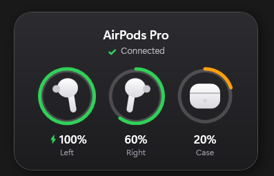

# WinPods

A small Windows app that shows a popup when your Apple AirPods connect, like a MacBook does. The popup shows the battery of the left earbud, the right earbud and the case.



## Install

1. Open the [Releases](../../releases) page and download the zip file of the latest release.
2. Unzip it.
3. Run `Install.cmd`.

WinPods starts right away and starts with Windows after that. You do not need administrator rights or .NET.

The app is not code-signed, so Windows SmartScreen may show a warning. Choose "More info", then "Run anyway".

To remove WinPods, open Settings, then Apps, and uninstall WinPods.

## What it does

- Shows a popup with the battery when your AirPods connect.
- Shows a popup when your AirPods disconnect.
- Shows a popup with the battery when you open the case lid with the AirPods inside.
- The popup closes by itself after 10 seconds. The ring in the top-right corner shows the time left. Click the popup to close it sooner.
- Runs in the notification area. Right-click the icon to turn "Start with Windows" on or off, or to exit.

## Notes

- Pair your AirPods with Windows first, in Settings, then Bluetooth & devices.
- Battery comes from the Bluetooth signal of the AirPods, so keep them close to the PC. The case level shows only while the lid is open.
- Needs Windows 10 (version 2004) or Windows 11 with Bluetooth.

## Build from source

Install the .NET SDK, then run:

```
powershell -ExecutionPolicy Bypass -File installer\build-installer.ps1
```

The installer folder appears in `dist\WinPods-Setup`.
